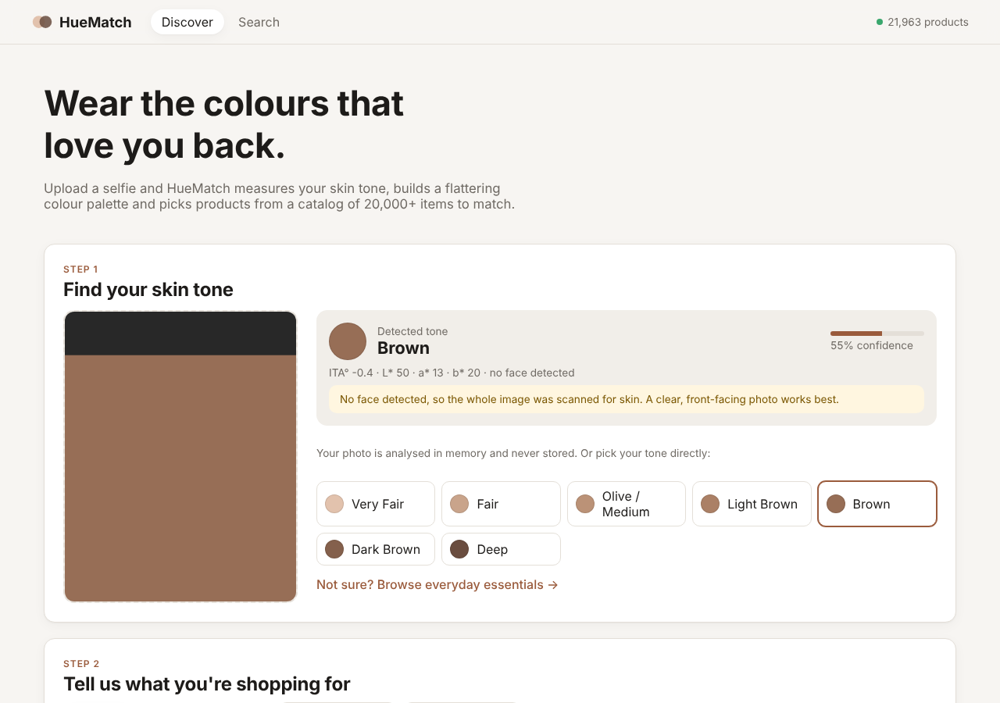
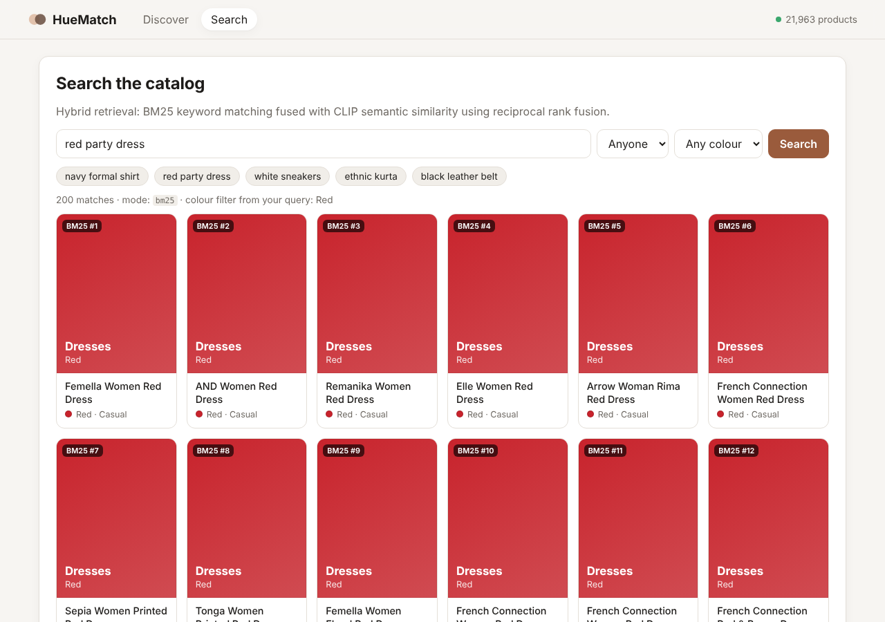
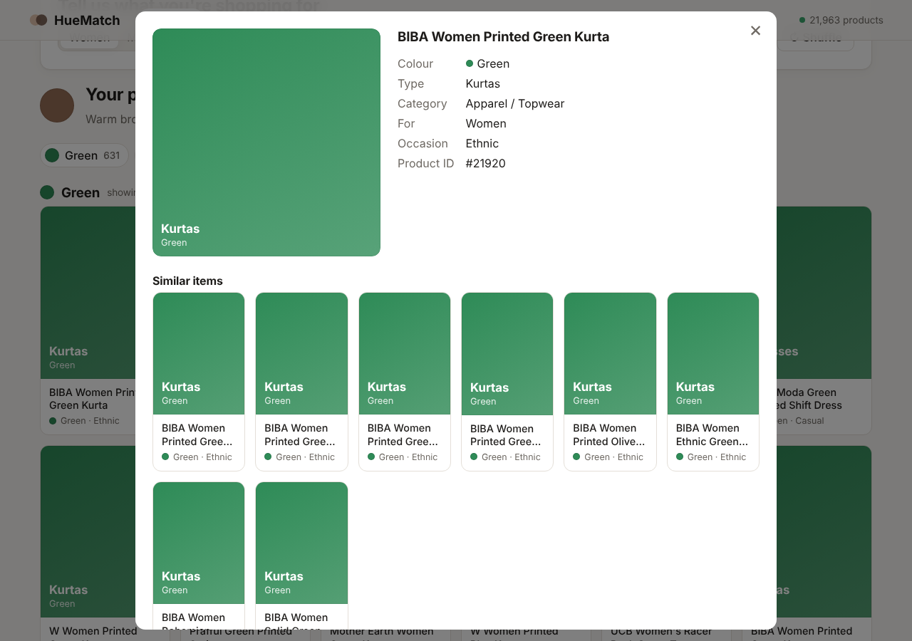
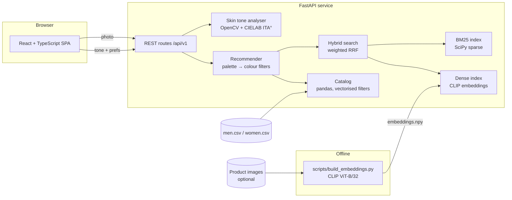

# HueMatch: fashion recommendations for your skin tone

HueMatch is a full-stack recommendation platform. Upload a selfie and it **measures your skin tone with computer vision**, builds a **colour palette** that suits you, and recommends products from a **22,000-item catalog** in those colours. It also has **hybrid semantic search** (BM25 + CLIP) across the whole catalog.

The project started as two research notebooks (`notebooks/`) that tried CLIP + BM25 retrieval in Jupyter. This repo turns them into a tested, containerised web application.



| Hybrid search | Product detail + similar items |
|---|---|
|  |  |

## Features

- **Photo-based skin tone detection**: face detection, skin segmentation and a CIELAB colour measurement. Returns the tone, a confidence score and the measured skin colour. Near a tone boundary it also suggests the neighbouring tone.
- **Palette recommendations**: 7 skin tone groups plus an "everyday essentials" set. Each maps to recommended colours, and products are grouped by colour, with filters for gender, category and occasion, free-text refinement, and a shuffle for variety.
- **Hybrid search**: sparse BM25 and dense CLIP retrieval merged with weighted Reciprocal Rank Fusion. Colours named in the query ("red party dress") are parsed and applied as a filter.
- **Similar items**: neighbouring products by CLIP embedding (or by text when embeddings are not built).
- **Production setup**: FastAPI with OpenAPI docs, typed schemas, 36 automated tests, Ruff, a multi-stage Docker image, Docker Compose and GitHub Actions CI.

## Architecture



### How skin tone detection works

1. **Face detection**: an OpenCV Haar cascade finds the largest frontal face. The analyser crops the central part of the face (skipping hair, background, eyes and mouth).
2. **Skin segmentation**: it keeps pixels inside a YCrCb skin range and drops shadows and specular highlights.
3. **Colour measurement**: the remaining pixels are converted to CIELAB, and a trimmed median (15th to 85th percentile of lightness) resists uneven lighting.
4. **Classification**: it computes the **Individual Typology Angle**, `ITA = arctan((L* − 50) / b*)`, a standard dermatology measure of skin colour (Chardon et al., 1991), and maps it to a tone group:

| Tone | ITA° range | Recommended colours |
|---|---|---|
| Very Fair | > 55 | Green, Navy Blue, Orange, Red, Blue |
| Fair | 41 to 55 | Navy Blue, Green, Yellow, Brown |
| Olive / Medium | 28 to 41 | Navy Blue, Maroon, Red, Green, Purple, Burgundy |
| Light Brown | 10 to 28 | Teal, Navy Blue, Blue, Burgundy, Grey |
| Brown | −10 to 10 | Green, Navy Blue, Blue, Yellow, White |
| Dark Brown | −30 to −10 | Black, Navy Blue, Pink, Burgundy, White, Grey |
| Deep | < −30 | Navy Blue, Maroon, Pink, Yellow, White, Grey, Orange, Blue |

Palettes live in [`backend/app/data/palettes.json`](backend/app/data/palettes.json) and are checked at startup against the catalog's colour vocabulary. Photos are processed in memory and never stored.

### How recommendations work

The notebooks ran a fuzzy semantic query per colour (`"red clothes for men"`), which could return products in other colours. HueMatch instead turns each palette colour into a **hard filter** on the catalog's `baseColour`, expanded to its colour family (e.g. Grey also matches Grey Melange). Every recommendation is therefore guaranteed to be in a recommended colour. Within each colour, products are ranked by hybrid search when the shopper types a refinement, or sampled with a seed otherwise.

### How search works

| Stage | Implementation | Why |
|---|---|---|
| Sparse | BM25 (k1 = 1.5, b = 0.75) over each product's metadata sentence, precomputed as a SciPy CSC matrix, with colour and article type boosted | A query is one sparse column-sum (about 1 ms over 22k products) |
| Dense | CLIP ViT-B/32 embeddings of product images, falling back to text, compared to the CLIP text embedding of the query | Matches meaning, not just words ("sneakers" finds sports shoes) |
| Fusion | Weighted Reciprocal Rank Fusion (k = 60, dense weight 0.6) over the top 200 from each retriever | Robust to the two retrievers' different score scales |
| Query parsing | Colour names in the query become a filter, with a fallback if nothing matches | Stops rare words outranking the colour the shopper asked for |

At this catalog size an exact NumPy matrix product beats an approximate-nearest-neighbour service, so no vector database is needed. `DenseIndex` is a small seam where Qdrant or FAISS could be dropped in at larger scale.

## Quick start

### Docker (single container, API + UI)

```bash
docker compose up --build
# open http://localhost:8000  ·  API docs at http://localhost:8000/docs
```

### Local development

```bash
make install        # Python + npm dependencies
make api            # FastAPI on :8000 (auto-reload)
make web            # Vite dev server on :5173, proxies /api → :8000
```

Requires Python 3.11+ and Node 20+.

### Optional: product images and CLIP search

Without these the app runs BM25-only search and shows colour tiles in place of photos.

1. Download [Fashion Product Images (Small)](https://www.kaggle.com/datasets/paramaggarwal/fashion-product-images-small/data) and put the `images/` folder at `data/images/`.
2. Build embeddings:
   ```bash
   make install-ml
   make embeddings     # writes data/embeddings/, using images where available and text otherwise
   ```
3. Restart the API. `/api/v1/health` will report `search_mode: hybrid (bm25 + clip-image)`.

With Docker, run `INSTALL_ML=true docker compose up --build`.

## API

Interactive docs are at `/docs` (Swagger) and `/redoc`.

| Method | Endpoint | Description |
|---|---|---|
| `GET` | `/api/v1/health` | Status, catalog size, search mode |
| `GET` | `/api/v1/skin-tones` | Tone groups with palettes |
| `POST` | `/api/v1/skin-tone/analyze` | Multipart `image`, returns tone, ITA°, L\*a\*b\*, confidence |
| `GET` | `/api/v1/recommendations` | `skin_tone`, `gender`, `category`, `sub_category`, `usage`, `q`, `per_color`, `seed` |
| `GET` | `/api/v1/products/search` | `q`, `color`, filters, `limit`, `offset`, with per-retriever ranks |
| `GET` | `/api/v1/products/{id}` | Product detail |
| `GET` | `/api/v1/products/{id}/similar` | Similar products |
| `GET` | `/api/v1/products/{id}/image` | Product image (when images are installed) |
| `GET` | `/api/v1/facets` | Filter values with counts |

```bash
curl -F image=@selfie.jpg localhost:8000/api/v1/skin-tone/analyze
curl "localhost:8000/api/v1/recommendations?skin_tone=olive&gender=Women&category=Apparel&usage=Ethnic"
```

## Project structure

```
├── backend/
│   ├── app/
│   │   ├── api/routes.py        REST endpoints
│   │   ├── core/
│   │   │   ├── catalog.py       loading, cleaning, vectorised filtering
│   │   │   ├── colors.py        colour vocabulary, families, query colour parsing
│   │   │   ├── palettes.py      tone groups, ITA → tone mapping
│   │   │   ├── recommender.py   palette-driven recommendations
│   │   │   ├── search.py        BM25, dense index, weighted RRF
│   │   │   └── skin_tone.py     face detection → skin segmentation → ITA
│   │   ├── data/palettes.json
│   │   ├── config.py            env-driven settings (HUEMATCH_*)
│   │   ├── schemas.py           Pydantic response models
│   │   ├── services.py          startup wiring
│   │   └── main.py              app factory
│   ├── scripts/build_embeddings.py
│   └── tests/                   36 pytest tests (unit + API)
├── frontend/                    React 19 + TypeScript + Vite
├── data/                        product metadata CSVs (+ optional images/embeddings)
├── notebooks/                   original research notebooks
├── Dockerfile, docker-compose.yml, Makefile
└── .github/workflows/ci.yml     lint, test, build, Docker smoke test
```

## Testing

```bash
make test    # pytest + TypeScript type-check
make lint    # ruff
```

The tests cover BM25 ranking, rank fusion with a dense retriever, loading and aligning embeddings, catalog cleaning and filters, ITA maths, skin tone classification on calibrated colour samples, error handling for bad uploads, and every API endpoint.

## Limitations and roadmap

- Skin tone estimates depend on lighting and camera white balance. They are a styling aid, not a medical assessment. Next steps: white-balance correction against a reference, and undertone (warm/cool) detection.
- The palettes are rule-based. With interaction data (clicks, saves), a learning-to-rank model could personalise the order within each colour.
- Planned: user accounts and saved looks, outfit composition (top + bottom + footwear that work together), and an evaluation set with NDCG for search quality.

## Dataset

Product metadata and images come from the [Fashion Product Images (Small)](https://www.kaggle.com/datasets/paramaggarwal/fashion-product-images-small/data) dataset by Param Aggarwal on Kaggle.
